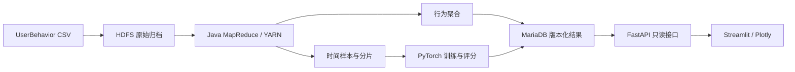

# 行为观察 · Hadoop 用户行为分析与预测系统

面向亿级电商用户行为日志的分析与预测项目，覆盖数据导入、Hadoop 清洗聚合、时间样本构建、模型训练、版本发布和可视化查询。通过七页中文工作台，查看浏览、购买、加购与收藏的变化，分析商品、类目和用户活跃情况，并追踪数据质量、真实作业与模型实验。

## 主要功能

- **行为与实体分析**：四类行为统计、区间精确去重用户数、按日/小时趋势、活跃热力图、商品与类目排行及单实体趋势。
- **用户活跃与回访**：每日活跃、首次观察用户、次日复访和用户活动查询；观察期末日的次日复访保留为空。
- **三种预测模型**：CONSTANT、LOGISTIC、GRU，使用过去 48 小时行为，预测未来 24 小时是否记录购买；历史测试与未观测的未来窗口分别展示。
- **模型实验对比**：按时间划分训练、验证和测试数据，展示评价指标、训练曲线、校准分桶、混淆矩阵及真实 CPU/CUDA 性能对照。
- **流程与版本管理**：来源与质量审计、真实 YARN 任务追踪、原子发布与回滚、只读 API、汇总报告导出和备份恢复工具。

工作台包含 **行为总览、商品与类目、用户活跃、行为预测、模型实验、数据质量与任务、版本与方法** 七个页面，支持桌面和窄屏浏览。

## 技术与数据



HDFS 保存来源、事实、聚合、样本及模型归档；YARN 调度计算资源，MapReduce 执行清洗、统计与时间窗口处理，HistoryServer 提供作业历史。模型由独立的 PyTorch 进程训练，GRU 使用单卡 CUDA；样本按分片读取，避免把全量特征一次加载到内存。

运行环境为 **WSL2 / Ubuntu、Python 3.12、Java 11、Hadoop 3.4.2、MariaDB 10.11、PyTorch 2.6.0+cu124**，Python 依赖由 uv 和 `uv.lock` 管理。

数据来自 [天池 UserBehavior](https://tianchi.aliyun.com/dataset/649)，本地文件共 **100,150,807 行**，包含用户 ID、商品 ID、类目 ID、行为类型和 Unix 时间戳。分析窗口为北京时间 **2017-11-25 至 2017-12-04（不含）**；`pv`、`buy`、`cart`、`fav` 分别表示浏览、购买、加购和收藏。

购买次数表示 `buy` 行为记录，数据没有金额、订单号或商品名称。数据许可说明文字与链接的差异记录在[来源核验](docs/execution/2026-11-02-dataset-source.json)中；仓库不分发原始数据。

## 已验证结果与当前进度

| 项目 | 实际结果 |
|---|---|
| 全量数据处理 | 100,150,807 行完成处理；100 万、1000 万及全量分析规模阶梯通过 |
| 模型与预测 | 三种模型完成测试评价；3,653,540 条已发布预测逐条对账通过 |
| 查询性能 | 10 并发持续五分钟，共 26,804 次请求，p95 为 0.193 秒，错误率 0 |
| 页面与交互 | 七页覆盖 320–1440px 五种宽度，共 35 组页面与 85 组按钮状态检查通过 |

性能结果限于记录中的硬件、数据与测试负载；模型参数、阈值及模型选择仅使用验证集，测试集用于封存评价。当前部署为单机伪分布式、HDFS 副本 1；本机备份恢复仍在验收，独立介质备份尚未验收。

## 本机运行

先按[运行与验收手册](docs/execution/2026-11-02-runbook.md)准备依赖、数据库、Hadoop 和已发布数据，再在仓库根目录启动：

```bash
source scripts/dev-env.sh
python scripts/database-service.py start
scripts/hadoop-service.sh start
python scripts/web-service.py start
```

访问 **<http://127.0.0.1:8510>**，接口文档位于 **<http://127.0.0.1:8010/api/v1/docs>**。服务状态和停止命令：

```bash
python scripts/web-service.py status
python scripts/web-service.py stop
```

页面通过只读 API 查询固定的已发布版本。新数据经离线 CLI 处理、训练并发布后，可在页面切换到新版本；日常查看结果无需重新训练。

新克隆的仓库仅包含源码与文档。数据集需自行取得并放到项目的 `var/data/UserBehavior.csv`，数据库文件、模型、缓存与凭据均保留在被忽略的 `var/` 目录。换机器或安装路径时，需调整 `config/development.toml` 及 `config/hadoop/` 中的本机绝对路径；尚未发布时页面显示明确空态。

## 文档导航

| 内容 | 入口 |
|---|---|
| 环境与初始化 | [环境搭建记录](docs/execution/2026-11-02-environment.md) · [数据库迁移](migrations/README.md) |
| 运行与维护 | [启动、发布、恢复与空间管理](docs/execution/2026-11-02-runbook.md) |
| 数据与计算 | [数据导入](ingest/README.md) · [MapReduce 作业](jobs/README.md) · [时间样本与分片](ml/README.md) |
| 算法与服务 | [模型与评价设计](docs/07-models.md) · [API 契约](docs/08-api.md) · [OpenAPI](service/openapi.json) |
| 实测与优化 | [全量数据链路验收](docs/execution/2026-11-02-m123-acceptance.md) · [发布与应用验收](docs/execution/2026-11-03-m5-m6-acceptance.md) · [查询优化](docs/execution/2026-11-02-query-optimization.md) |
| 页面设计 | [侧栏交互与响应式边界验收](docs/execution/2026-11-03-ui-interaction-plan.md) |
| 设计与进度 | [冻结设计基线](docs/README.md) · [后续开发执行记录](docs/execution/2026-11-02-m4-m7-development.md) |
