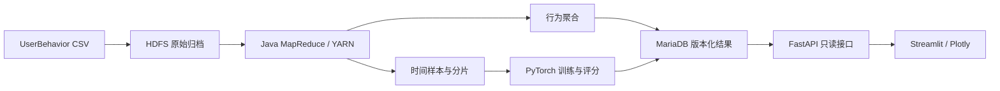

# 零售观察：Hadoop 电商用户行为分析与预测系统

面向亿级电商用户行为日志的分析与预测项目，覆盖数据导入、Hadoop 清洗聚合、时间样本构建、PyTorch 模型训练、版本化发布与七页中文可视化工作台。

## 核心能力

- **行为与实体分析**：四类行为（`pv`、`buy`、`cart`、`fav`）统计、区间精确去重 UV、按日/小时趋势、活跃热力图、商品与类目排行及单实体趋势。
- **用户活跃与回访**：每日活跃、首次观察用户、次日复访和用户活动查询（观察期末日的次日复访保留为空）。
- **三种预测模型**：`CONSTANT`、`LOGISTIC`、`GRU`，使用过去 48 小时行为预测未来 24 小时是否出现购买；历史测试集与未观测的未来窗口分别展示。
- **模型实验对比**：按时间划分训练/验证/测试集，展示指标、训练曲线、校准分桶、混淆矩阵及 CPU/CUDA 性能对照。
- **流程与版本管理**：来源与质量审计、YARN 作业追踪、原子发布与回滚、只读 FastAPI 接口、汇总导出与备份恢复。

工作台包含 **行为总览、商品与类目、用户活跃、行为预测、模型实验、数据质量与任务、版本与方法** 七个页面，支持桌面和窄屏浏览。

## 系统架构



- **存储与计算**：HDFS 归档原始数据、事实、聚合、样本与模型；YARN + Java MapReduce 执行全量清洗、统计与窗口切分；PyTorch 独立进程在单卡 CUDA 上训练 GRU，样本按分片流式读取。
- **运行环境**：WSL2 / Ubuntu、Python 3.12（`uv` + `uv.lock`）、Java 11、Hadoop 3.4.2、MariaDB 10.11、PyTorch 2.6.0+cu124。
- **数据说明**：来自[天池 UserBehavior](https://tianchi.aliyun.com/dataset/649)（约 1 亿条记录，分析窗口为北京时间 `2017-11-25` 至 `2017-12-04` 不含）。`buy` 表示购买行为记录，不含金额、订单号或商品名称；仓库不分发原始数据。

## 快速启动

### 1. 准备运行环境与数据

新克隆的仓库仅包含源码与文档：
1. 将原始数据集放到 `var/data/UserBehavior.csv`（或在 `config/development.toml` 中配置 `[source].path`）。
2. 初始化本地依赖与数据库/Hadoop 服务：

```bash
source scripts/dev-env.sh
python scripts/bootstrap-tools.py          # 下载并校验 Java 11 / Hadoop 3.4.2 到 var/tools/
python scripts/database-service.py init    # 初始化独立 MariaDB 实例与 var/secrets/*.cnf
scripts/hadoop-service.sh init             # 格式化本地 HDFS NameNode
```

### 2. 启动服务

```bash
source scripts/dev-env.sh
python scripts/database-service.py start
scripts/hadoop-service.sh start
python scripts/web-service.py start
```

访问工作台 **<http://127.0.0.1:8510>**，接口文档位于 **<http://127.0.0.1:8010/api/v1/docs>**（端口均可通过 `config/development.toml` 配置）。

常用管理命令：

```bash
python scripts/web-service.py status
python scripts/web-service.py stop
scripts/hadoop-service.sh stop
python scripts/database-service.py stop
```

> **提示**：换机或更换目录时，只需更新 `config/development.toml` 中的路径与端口配置；`config/hadoop/` 已通过 `scripts/dev-env.sh` 注入环境变量，无硬编码绝对路径。数据库文件、模型、缓存与凭据均保存在被 `.gitignore` 忽略的 `var/` 目录中。

### 3. 运行测试

```bash
.venv/bin/pytest
# 如需运行依赖独立测试库 behavior_test_m123 的集成测试：
python scripts/setup-test-database.py
BEHAVIOR_INTEGRATION=1 .venv/bin/pytest
```

## 文档导航

| 内容 | 入口 |
|---|---|
| **Agent 任务交接** | [交接总览](docs/handoff/README.md) · [当前状态](docs/handoff/CURRENT-STATE.md) · [操作手册](docs/handoff/PLAYBOOK.md) |
| 设计基线与契约 | [设计文档总览](docs/README.md) · [模型设计](docs/07-models.md) · [API 契约](docs/08-api.md) |
| 各模块说明 | [数据导入](ingest/README.md) · [MapReduce 作业](jobs/README.md) · [时间样本与模型](ml/README.md) · [数据库迁移](migrations/README.md) · [OpenAPI](service/openapi.json) |
