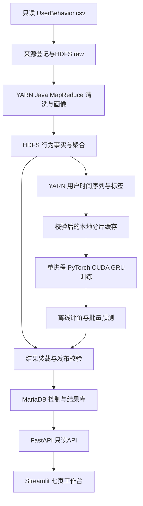

# 03 系统架构

UBA-DOC-1.0.0 / FROZEN。

Hadoop是核心执行引擎：清洗、精确去重计数、日聚合、用户序列与标签均运行在YARN；不得仅把文件放入HDFS而在Pandas执行全量业务。Java作业通过InputFormat分片、Shuffle外排和Reducer流式处理，资源由YARN管理。

训练属于单机GPU作业，不伪称Hadoop GPU训练。CLI调度器控制一个重任务租约：MapReduce、样本导出、训练、批量评分、大规模入库不同时执行。API可以查询已发布结果，训练期间性能单独记录。YARN不需要配置GPU调度插件。

HDFS是事实、特征、模型和审计产物的归档权威；本地缓存仅是校验后的可重建副本。MariaDB只存聚合、用户日状态、预测和控制表，不装载一亿行原始事件。模型checkpoint由离线进程加载，Web不持有GPU，不执行即时预测。

事实文件采用SequenceFile块压缩，typed Writable记录、schema写入manifest；没有Parquet/Hive/Spark依赖。训练导出固定形状的Numpy分片（非压缩npz，允许mmap），块大小和字段见04；不把全部样本读入内存。SequenceFile采用内置压缩，具体codec锁入环境，禁止不可切分的单个gzip作为计算事实输入。

## 模块职责

- ingest：只读源、哈希、归档、登记；不承担业务聚合。
- jobs：Java MR，正式输出必须关联真实application ID。
- orchestration：DAG、参数hash、租约、重试、来源与发布校验。
- ml：分片加载、三模型、评估、GPU记录、离线预测。
- service/app：只读结果、业务解释与版本固定。

## 一致性与规模

每阶段输出至同父临时目录，成功后校验schema/hash/count并HDFS rename，随后登记SUCCEEDED；DB登记失败可据同一manifest补录。发布先批量装载STAGING版本，校验后短事务置READY并切current，旧请求仍可访问旧release。

单机伪分布式、HDFS副本1不提供硬件故障容错。可扩展性来自按键分区、有界状态和配置化Reducer；未来多节点可增加副本与算力，但本基线只验收本机。不存在已验证的十亿级或实时能力。
